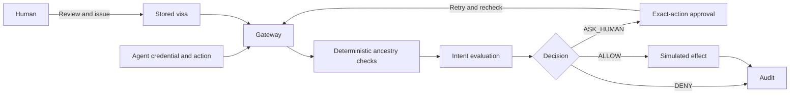

# Architecture

The gateway is an enforcement point. `/execute` both authorizes an exact action and invokes the protected simulation adapter. There is no public tool route that skips authorization. Agent identity comes from a server-side credential mapping, not a request field. Visas are opaque IDs referencing stored contracts.

| Module | Responsibility |
| --- | --- |
| `models.py` | Strict contracts/actions and bounded mission drafting |
| `tools.py` | Closed schemas, trusted catalog and exact destinations |
| `policy.py` | Deterministic checks and delegation attenuation |
| `intent.py` | Structured evaluator interface and procurement baseline |
| `semantic.py` | Optional remote review that cannot relax the baseline |
| `gateway.py` | Transactions, budgets, approvals, effects and audit |
| `api.py` | Credential separation, bounded HTTP bodies and operator routes |
| `operator.py` | Human-only control client and exact-action review workflow |
| `transport.py` | Shared validation of trusted gateway origins |
| `mcp_server.py` | Agent-only stdio bridge to the same HTTP enforcement boundary |
| `evaluation.py` | Labeled regression runner and metrics |

## Transactions and retries

Execution acquires a SQLite `BEGIN IMMEDIATE` transaction. The gateway reads current ancestry, interprets arguments, checks policy, evaluates intent, writes the simulated effect, updates all ancestor usage and appends an audit record. Failure rolls back the transaction. Concurrent writers serialize, preventing sibling agents from spending the same remaining budget.

Request IDs are scoped to the authenticated identity and bound to a canonical hash of the complete action, including context. Reusing an ID with different arguments is denied. Completed requests return stored results without another effect. A replayed successful response describes a previous execution, not a fresh authorization grant. Completed denials are also cached; use a new request ID after correcting an action.

Approvals expire at the earlier of five minutes or an ancestor's expiration. Approval alone does not execute anything. On retry, the gateway rechecks all current policy and semantic denial. Edits invalidate outstanding approvals across the affected subtree. Hard denials cannot be approved. The operator CLI requires the action fingerprint shown during inspection; the gateway atomically checks it when supplied and records it with the human review. Legacy API clients may omit this additional review check.

## Delegation

Parent pointers preserve the full chain. Child allowed sets must be subsets; forbidden sets retain all parent restrictions. Budget, transaction limit, action count, approval threshold and expiration cannot increase. Depth decreases. Identity can change, while mission and canonical purpose remain the same.

Authority is shared rather than reserved when delegated. Multiple children can each have a nominal cap equal to the parent, but aggregate usage cannot exceed the parent's current cap. Descendants remain subject to later ancestor restrictions and revocation. Snapshot parent pointers allow reconstruction of the delegation graph.

## Audit and tradeoffs

Authorization records include principal, exact action, mission, ancestry, policy checks, intent diagnostics, cost, impact, decision, human intervention and latency. Lifecycle changes and human reviews are also recorded. HTTP authentication/schema failures occur before the engine and are not decision records; production deployments need separate redacted boundary logs.

The hash chain is locally verifiable, not tamper-proof. A database administrator can rewrite the chain or truncate its tail. Strong evidence requires externally anchored checkpoints and protected retention.

SQLite is a local single-host ledger. Semantic review currently holds the writer transaction; remote latency reduces throughput. Production should perform expensive review outside the critical section and then revalidate versioned policy and effect metadata before reserving authority.

All effects are database records in the same transaction. Real payments/messages require durable reservations or an outbox, provider idempotency, reconciliation and unknown-outcome handling. Replacing the insert with an HTTP call would invalidate the present atomicity guarantee.
